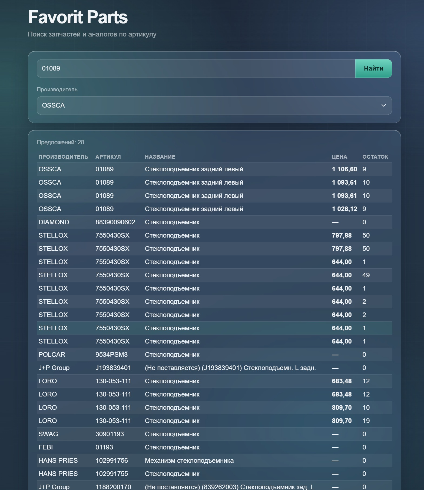

# Favorit Parts — поиск запчастей



React-приложение для двухэтапного поиска автозапчастей и аналогов через API Favorit Parts (`hsprice`).

## Стек

- React + Redux Toolkit (JavaScript)
- Bootstrap + свой CSS
- Express-proxy (ключ API только на сервере)

## Требования

- Node.js 18+
- npm

## Настройка окружения

1. Скопируйте пример env:

```bash
cp .env.example .env
```

На Windows (PowerShell):

```powershell
Copy-Item .env.example .env
```

2. Укажите ключ покупателя Favorit:

```env
FAVORIT_API_KEY=ваш-ключ
```

В `.env.example` только шаблон без значения. Ключ возьмите из кабинета / документации Favorit и пропишите в `.env` (в git не попадает).

Опционально:

```env
PORT=3001
```

## Запуск

```bash
npm install
npm run dev
```

Откроется:

- UI: http://localhost:5173
- Proxy: http://localhost:3001

По отдельности:

```bash
npm run server
npm run client
```

## Сборка

```bash
npm run build
```

Статика в `dist/`. Proxy при этом всё равно нужен для `/api/price` (ключ и запросы к Favorit).

## Как пользоваться

1. Введите артикул → получите список производителей.
2. Выберите производителя → получите исходную позицию, аналоги и предложения по складам (цена и остаток из `warehouses`).

## Проверка API (smoke)

Сырые ответы и отчёт лежат в `smoke/SMOKE_REPORT.md`.

## Структура

```
server/          Express proxy → Favorit HTTPS
src/api/         клиент к /api/price
src/store/       Redux Toolkit
src/components/  форма, бренды, таблица
src/utils/       mapOffers, isEmptyGoods, apiError
smoke/           фикстуры и отчёт smoke
```
